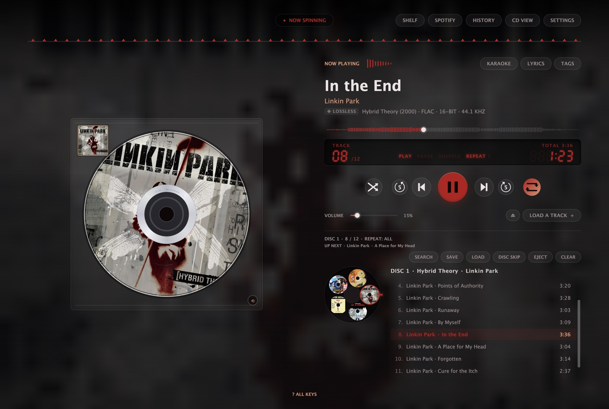
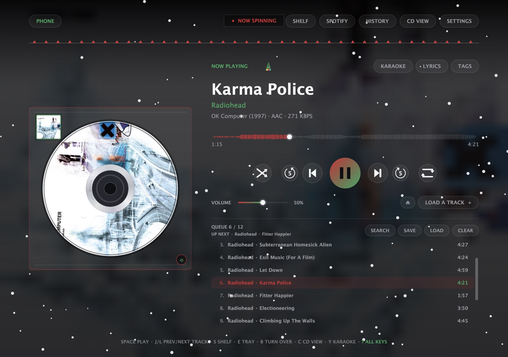
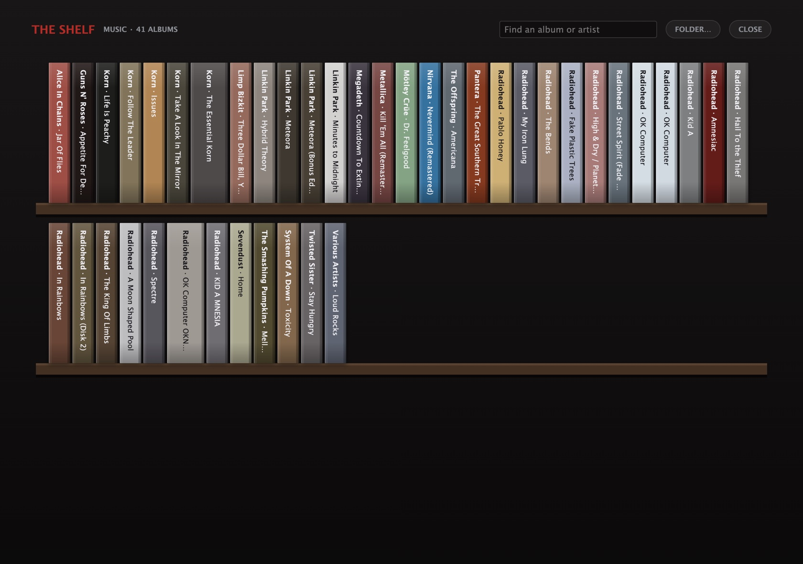
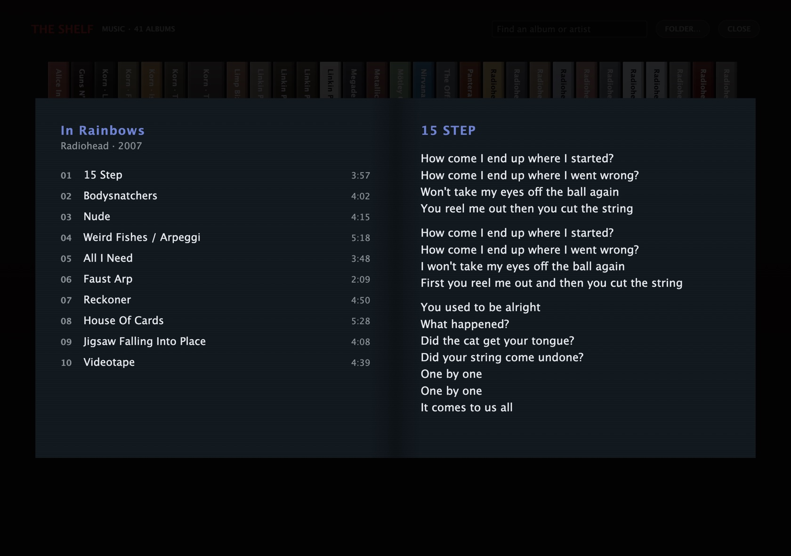
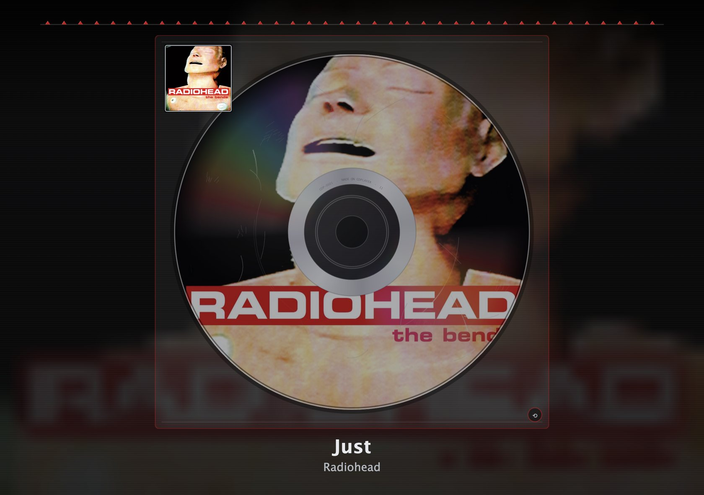
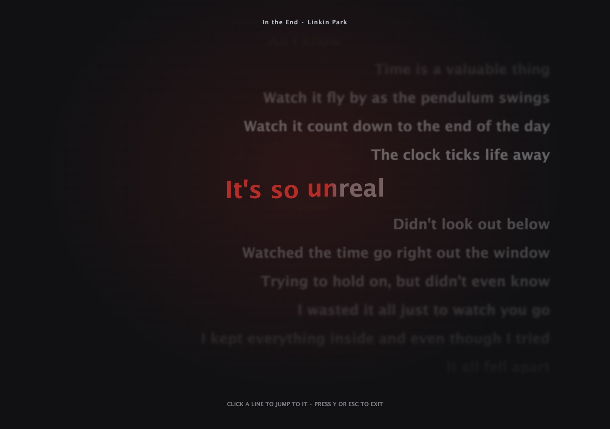
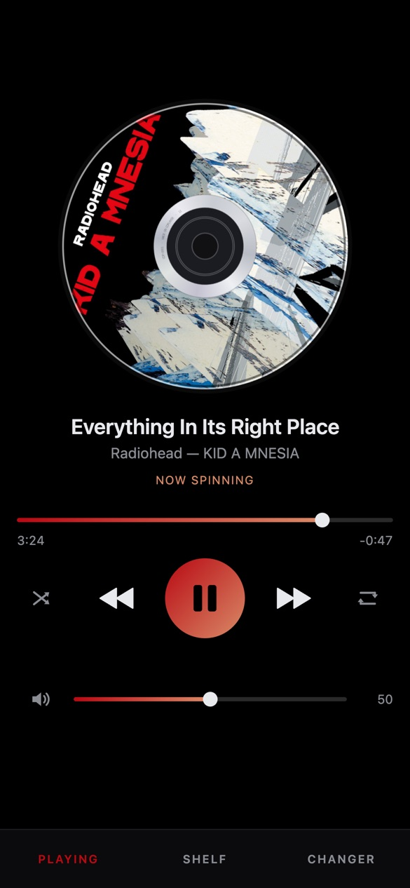
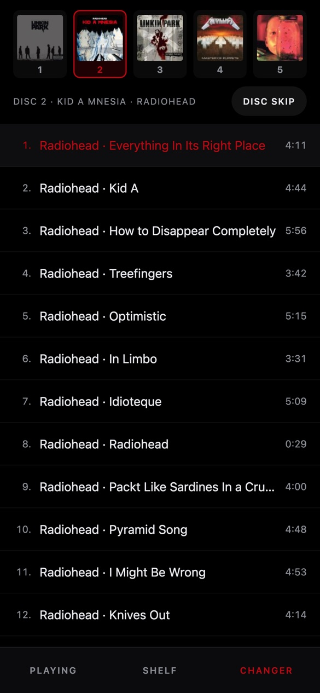

# CDPlayer

A desktop music player that feels like a real CD player — for your local music, your CDs, and (with Spotify Premium) your Spotify albums. No account, nothing else to install: MP3, M4A/ALAC, FLAC, WAV, AIFF, AU, OGG and Opus all play out of the box on macOS, Windows and Linux.

<p align="center">
  
  
</p>

## Download

Grab the file for your system from [**Releases**](https://github.com/Kizarov3/CDPlayer/releases):

| System | File | How to run |
| --- | --- | --- |
| **macOS** (Apple Silicon and Intel) | `CDPlayer-x.y.z-mac.dmg` | Open it, drag **CDPlayer** into **Applications** |
| **Windows** 10 / 11 | `CDPlayer-x.y.z-windows.exe` | Double-click — no installation |
| **Linux** | `CDPlayer-x.y.z-linux.AppImage` | `chmod +x`, then double-click |

The builds aren't signed with a paid certificate, so the first launch asks once: on macOS right-click the app → **Open** → **Open**; on Windows **More info** → **Run anyway**.

### Updating

When a new version is out, an **AVAILABLE** button appears in the player's top-left corner: click it to download the update (checked against the release's SHA-256), then **RESTART TO UPDATE** — CDPlayer puts the new version in place of the one you run and opens it, your queue kept. This works from 2.13.0 on.

- **macOS** — keep CDPlayer in **Applications**. Run from the disk image or from Downloads, it can't replace itself: the update is saved to Downloads and **INSTALL** opens it to drag into Applications.
- **Windows** — run the `.exe` from a folder, not from inside a .zip. It's updated where it is, so it keeps its old file name.
- **Linux** — the AppImage updates itself; a CDPlayer installed from a package is updated the usual way (the button saves the download and shows it).
- In a folder CDPlayer can't write to, the update is saved to Downloads and shown to you.

## Features

- **The disc** — spins in its jewel case with your cover printed on it, catches the light as you move the mouse (**DISC SHINE** turns it off), wears scratches as you play it, turns over (`B`) to show a ring for each track, can be turned by hand like a DJ's jog wheel, and shows on the Dock or taskbar icon (**DISC ICON**)
- **The CD shelf** (`S`) — every album in your music folder spine-out, kept up to date as you add, rip or remove albums, sorted by artist, year, most played, last played (a divider for each month), colour, or behind dividers of your own (**+ DIVIDER** in a case: "For the car", "Sunday"). An album's editions — the original, the deluxe, the remaster — stand as one spine, with a switch in its case. Several music folders can share it — an external drive too, kept on the list while it's unplugged. Unplayed albums gather dust (wipe it off with the mouse), new ones come shrink-wrapped, sticky notes on cases, and the studio albums you're missing stand as see-through places. An album you started from its first song and left part-way has a ribbon bookmark on its spine and **CONTINUE · TRACK n** in its case. **SHOW** narrows the shelf to the dusty albums, the ones still wrapped, left part-way, with a note or never played, or one decade or genre — and **PULL ONE** pulls one of them out at random, the dustier the likelier (in the changer, **FILL** loads five of them, or keeps it full: each finished disc makes room for another)
- **The booklet** — the album's tracklist, lyrics and credits, marked in pen as you play: tally marks per song, your favourite circled, and on the back cover how many times you've played the album start to end
- **Discogs** — each album's exact pressing and market price, on its case, sticker and receipt; **APPRAISE** values your whole shelf
- **Audio CDs** — play a real CD, named from MusicBrainz, or **RIP** it to verified, tagged FLAC in one click
- **Lyrics & Karaoke** (`Y`) — lyrics found online, highlighted word by word as they're sung
- **Spotify** (Premium) — your saved albums and playlists play as discs, with lyrics and karaoke
- **CD changer** — a mode (Settings → CD CHANGER): five discs in a carousel instead of the queue, each keeping its own music; albums, folders, `.m3u` playlists, Spotify and real CDs go in as discs; SHUFFLE and REPEAT for this disc or all of them (each mode keeps its own, across restarts), DISC SKIP (`D`) and `1`–`5` to play a slot
- **The deck's display** — under the seek bar, a dark window like a CD player's front panel: the track number and the time in glowing seven-segment digits, TOTAL above, PLAY / PAUSE / SHUFFLE / REPEAT lit between; click the time to count down what's left. In CD view it sits under the album's name (Settings → DISPLAY → CLASSIC brings back the plain times)
- **History** — the songs you've played under TODAY, YESTERDAY and each day before, with the time each was last played. **IMPORT PLAYS** brings in what you played on Spotify, Last.fm, ListenBrainz or Apple Music, counted on the same songs; **scrobbling** to Last.fm and ListenBrainz sends on what you play here
- **YouTube Music & SoundCloud** — turned on in Settings → LIBRARY, the search (`/`) finds albums on YouTube Music and songs on SoundCloud, and they play like your own discs — gapless, with the EQ, in the queue and HISTORY (unofficial, through the free yt-dlp; songs a label has locked don't play)
- **Hidden tracks** — a song hidden after minutes of silence at the end of a disc's last track (*Nevermind*'s "Endless, Nameless") is found: the silence plays as on the CD with a countdown to it, and the song is named when it begins and written into the booklet
- **Phone remote** — turn it on in Settings → PHONE REMOTE and scan the QR code with your phone's camera: a remote opens in the phone's browser on the same Wi-Fi, with nothing to install and no account, and nothing goes over the internet. Play and pause, skip, volume, seek, SHUFFLE and REPEAT, pick albums from the shelf, rearrange the queue, and use the changer's discs
- **Playback** — gapless playback (an album's tracks run into each other, as on the CD), the queue (drag to reorder, PLAY NEXT), **SKIP** on a song in its case (an intro, a skit: passed over as the music moves on, still played when picked), AUTOMIX (the next song comes in where this one winds down) or crossfade, 10-band EQ with presets, output device picker, sleep timer (in minutes or at the end of the disc), `.m3u` playlists, media keys
- **Each output its own sound** — the EQ, mono and spatial audio set on your headphones come back when they're plugged in, the speakers' when they're the output again
- **Spatial audio** — for headphones: any song — a file, a CD or a rip — heard from two speakers in front of you instead of from inside your head; **SPACE** sets how much
- **Quality** — as in Apple Music: LOSSLESS and HI-RES LOSSLESS play each song at its own sample rate (up to 192 kHz), with your headphones' or DAC's rate switched to match on macOS and Windows and put back when CDPlayer closes; a ◈ LOSSLESS badge says what reaches the output
- **Sound Check** — every song at the same loudness (−18 LUFS), from its ReplayGain tags or measured once; **ALBUM** keeps an album's quiet and loud songs as they were made
- **Now Playing card** (`P`) — a picture or short video of the album and lyrics to share; Discord *Listening to* status
- **PLAYER LOOK** (Settings → LOOK) — CLASSIC, DOCK (the keys in a bar along the bottom), STAGE (the disc in the middle, the queue sliding in at the side), GLASS, PANEL or COVER (the album's cover instead of the disc)
- **Make it yours** — ten themes with animated scenes, your own themes shared as a file or code, Mini Mode (`M`), CD view, Visualizer Mode
- **Library tools** — search (`/` or `⌘K`) by artist, album or song, and for what to do or a setting ("shuffle", "crossfeed"); fix tags from MusicBrainz (**PUT BACK THE ORIGINAL** undoes it), find missing covers, spot duplicates and broken files
- **COPY REPORT** in Settings → HELP — the version, your system, the output and sound settings and what happened lately, in one paste for a bug report (no paths to your music's files)
- **A guide round the window** — the first time CDPlayer opens, each part lights up in turn with a word on what it does and how it works; again any time from Settings → SHOW THE GUIDE
- **Languages** — English and Russian; adding one is a single file ([docs/TRANSLATING.md](docs/TRANSLATING.md))

<p align="center">
  
  
</p>
<p align="center">
  
  
</p>
<p align="center">
  
  
</p>

## Keyboard shortcuts

| Key | Action |
| --- | --- |
| `Space` or `K` | Play / Pause |
| `J` / `L` | Previous / next track |
| `D` | Next disc in the changer |
| `1`–`5` | Play the disc in that slot of the changer |
| `←` / `→` | Skip back / forward 5 seconds |
| `↑` / `↓` | Volume up / down |
| `U` | Mute / unmute |
| `F` | Toggle fullscreen |
| `C` | Toggle CD view |
| `M` | Toggle Mini Mode |
| `V` | Toggle Visualizer Mode |
| `Y` | Toggle Karaoke Mode |
| `E` | Open / close the disc tray |
| `S` | The CD shelf |
| `/` or `⌘K` / `Ctrl+K` | Search your music, and what to do or a setting (Enter plays the first song found) |
| `B` | Turn the disc over to its data side: a ring for each track, the laser where it's playing |
| `P` | Now Playing card: pick lines of the lyrics, then copy or save it |
| `?` | These keyboard shortcuts |
| `Esc` | Close whatever's open, or leave fullscreen / CD view / Visualizer Mode / Mini Mode |
| `⌘Z` / `Ctrl+Z` | Bring back what CLEAR or EJECT just took out |
| `⌘O` / `Ctrl+O` | Open songs to play (LOAD A TRACK) |
| `,` or `⌘,` / `Ctrl+,` | Settings |
| `H` | History |

## FAQ

More answers are in the app: **Settings → HELP**.

**How do I choose my music folder?**<br>
Open the SHELF and click FOLDER…. To have more than one (say, an external drive too), click FOLDER… → ADD ANOTHER FOLDER…. Opening a song or saving a playlist somewhere else never changes the shelf. Songs outside the folders still play — drop them on the window.

**Where is my data kept?**<br>
In `~/.cdplayer` on Mac and Linux, `%LOCALAPPDATA%\CDPlayer` on Windows. Your music files are never changed unless you save tags or found art into them. To take it to another computer, use Settings → LIBRARY → BACKUP: **SAVE…** puts your queue, history, plays, notes, themes and settings in one `.cdbackup` file, **RESTORE…** puts them back — and a backup is also made by itself each day, the last 7 kept. Moved your music to another folder or drive? The shelf notices and offers to bring the songs' plays and history along.

**I switched QUALITY to HI-RES and hear no difference — is it working?**<br>
Point at the ◈ badge under the title: it says what reaches your output. MP3 and AAC files have no badge — QUALITY only plays lossless files (FLAC, ALAC, WAV, AIFF, CDs) at their own rate — and over Bluetooth the wireless codec decides. Even when it works, the difference is subtle; for a change you'll hear at once on headphones, turn on **SPATIAL AUDIO**.

**Does spatial audio work on CDs?**<br>
Yes — on CDs, rips and every file. Not on Spotify, whose audio is protected (the same reason the EQ can't reach it).

**The phone can't connect — what do I check?**<br>
That the phone is on the same Wi-Fi as the computer, and not a guest network (guest networks keep devices apart). On Windows, allow CDPlayer through the firewall on a **Private** network — Windows asks again after each update, and clicking Cancel blocks it silently (fix it in Windows Security → Firewall → Allow an app). **NEW CODE** in Settings signs every phone out.

**Does CDPlayer send anything over the internet?**<br>
Only lookups — covers, lyrics, album details from MusicBrainz and Discogs — and a check for a new version on GitHub (downloaded only when you click it). No account, no tracking. Spotify is contacted only if you connect it.

## Coming from the Java version?

The original lives at [Kizarov3/CDPlayer-Legacy](https://github.com/Kizarov3/CDPlayer-Legacy). Your queue, history, settings and Spotify sign-in carry over automatically.

## Spotify (optional)

Spotify lets each developer app play for only five people, so CDPlayer uses your own free one. The **SPOTIFY** button walks you through it:

1. Create an app at [developer.spotify.com/dashboard](https://developer.spotify.com/dashboard) with **Web API** and **Web Playback SDK** ticked
2. Add the redirect URI `http://127.0.0.1:8080/callback`
3. Under **User Management**, add your Spotify account's email
4. Paste the **Client ID** and **Client Secret** into the SPOTIFY panel and **CONNECT SPOTIFY**

Spotify's audio is protected, so the EQ, crossfade and visualizer don't apply to it. Works on macOS and Windows; on Linux it depends on Widevine support.

## Build from source

Needs [Node.js](https://nodejs.org) 20+.

```bash
npm install
npm start      # run the app
npm test       # unit tests
npm run dist   # build for the current OS into dist/
```

Pushing a `v*` tag builds, smoke-tests and releases all three platforms via [GitHub Actions](.github/workflows/build.yml).

## License

MIT — see [LICENSE](LICENSE). Tags are written with [node-taglib-sharp](https://github.com/benrr101/node-taglib-sharp) (LGPL-2.1-or-later), used unmodified.
